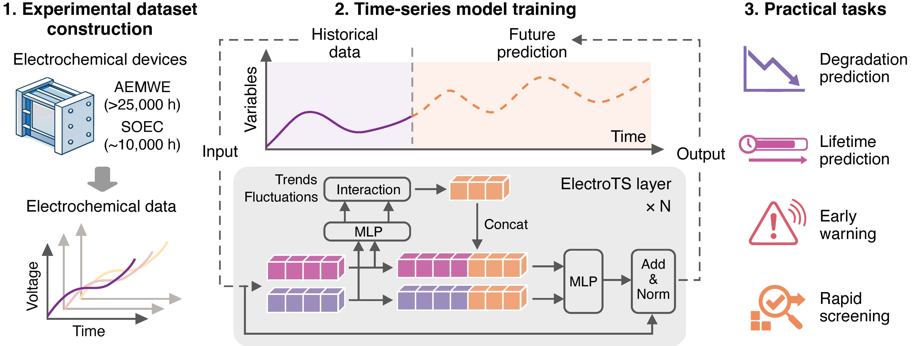

<div align="center">
  <h1>ElectroTS</h1>
</div>

<div align="center">

[](LICENSE)
[](https://www.python.org/)

**Long-horizon forecasting of electrolysis stability from early-stage operating data through temporal learning**

</div>

<p align="center">
  
</p>


## 🔍 Overview

ElectroTS is a data-driven electrolysis prognostic framework that integrates **data-adaptive rectification** with **temporal sequence modeling** to enable robust prediction of lifetime, degradation rates, and uncertainty in electrolytic systems.

Using only **early-stage operating data**, ElectroTS forecasts device stability over operating durations **exceeding tenfold the input window** and beyond **1,000 hours**, providing actionable guidance for rapid screening of materials and operating conditions. Few-shot transfer learning enables efficient cross-platform generalization across both low-temperature aqueous (AEMWE) and high-temperature solid-state (SOEC) electrolysis systems.

---

## 🚀 Installation

Python ≥ 3.10 is required. We recommend [uv](https://github.com/astral-sh/uv) for environment management.

```bash
pip install -e .
```

---

## 📌 Datasets

We construct two experimental stability datasets explicitly designed for long-horizon forecasting:

| Dataset | System | Abbrev. |
|---|---|---|
| Anion-exchange membrane water electrolysis | Low-temperature aqueous | AEMWE |
| CO₂ solid oxide electrolyzer cells | High-temperature solid-state | SOEC |


> **Data availability:** datasets will be made publicly available upon journal acceptance. Please check back or watch this repository for updates.

---

## 🔥 Model Training

### Method 1: training scripts

```bash
bash scripts/train_aemwe.sh   # AEMWE leave-one-out training
bash scripts/train_soec.sh    # SOEC fine-tuning (few-shot transfer)
```

### Method 2: CLI

After installation, the `electro-ts` command is available:

```bash
electro-ts \
  --model_id my_experiment \
  --root_path ./data/aemwe_all_p0.1 \
  --model ElectroTS \
  --time_cutoff 150 \
  --seq_len 1000 \
  --label_len 125 \
  --pred_len 250 \
  --e_layers 4 \
  --d_model 400 --d_core 400 --d_ff 400 \
  --learning_rate 0.0001 \
  --lradj cosine \
  --train_epochs 20 \
  --patience 20 \
  --batch_size 32 \
  --save_model
```

Equivalent alternatives:
```bash
python train.py   [same args]   # convenience script
python -m electro_ts [same args]  # module invocation
```

---

## 🗂️ Repository Structure

```
ElectroTS/
├── train.py                   # Convenience entry point
├── pyproject.toml             # Package metadata and dependencies
├── scripts/
│   ├── train_aemwe.sh
│   └── train_soec.sh
└── electro_ts/                # Installable package
    ├── cli.py                 # Argument parser + leave-one-out loop
    ├── exp/
    │   ├── exp_basic.py       # Base experiment class
    │   └── aemwe.py           # Train / validate / test / predict
    ├── models/
    │   ├── ElectroTS.py       # Model
    │   └── layers/
    │       ├── embed.py
    │       └── transformer_enc_dec.py
    ├── datasets/
    │   ├── data_factory.py
    │   └── data_loader.py     # ElectroDataset
    └── utils/
        ├── tools.py           # EarlyStopping, AverageMeter, LR scheduler
        └── eval.py            # decay_rate, lifetime, compute_errors
```

---

## 📝 Citation

If you find this work useful, please cite:

```bibtex
@article{electro_ts_2026,
  title   = {Long-horizon forecasting of electrolysis stability from early-stage
             operating data through temporal learning},
  author  = {},
  journal = {},
  year    = {2026},
  note    = {Preprint}
}
```

<!-- > Citation details will be updated upon publication. -->

---

## 🌈 Acknowledgements

This work was supported by the EPFL Solutions4Sustainability CCUS project and by the NCCR Catalysis (grant number 225147), a National Centre of Competence in Research funded by the Swiss National Science Foundation.

---

## 📫 Contact
If you have any question, welcome to contact me at:

Junwu Chen: junwu.chen@epfl.ch